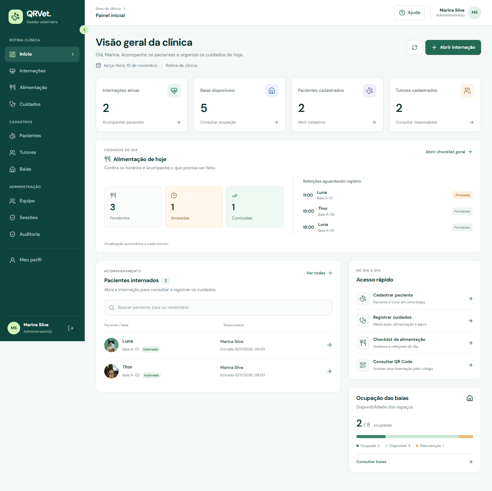
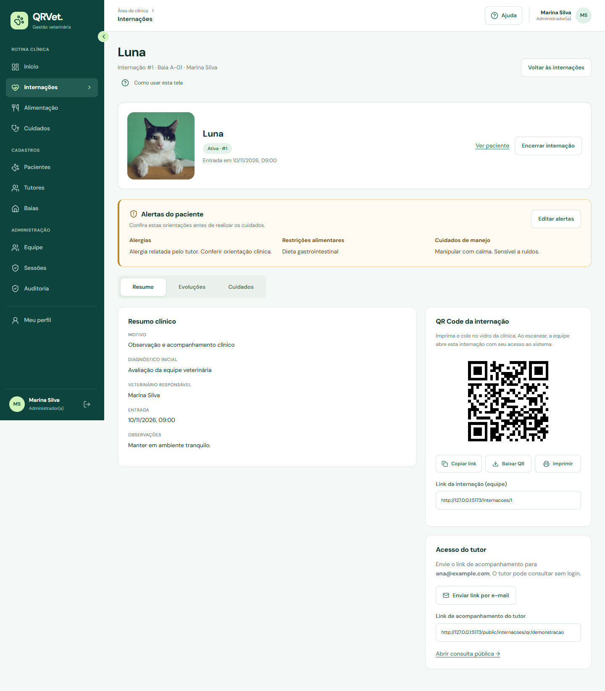
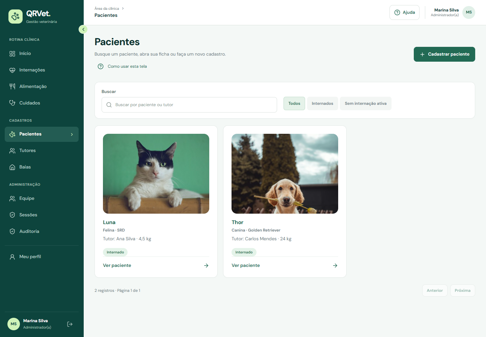
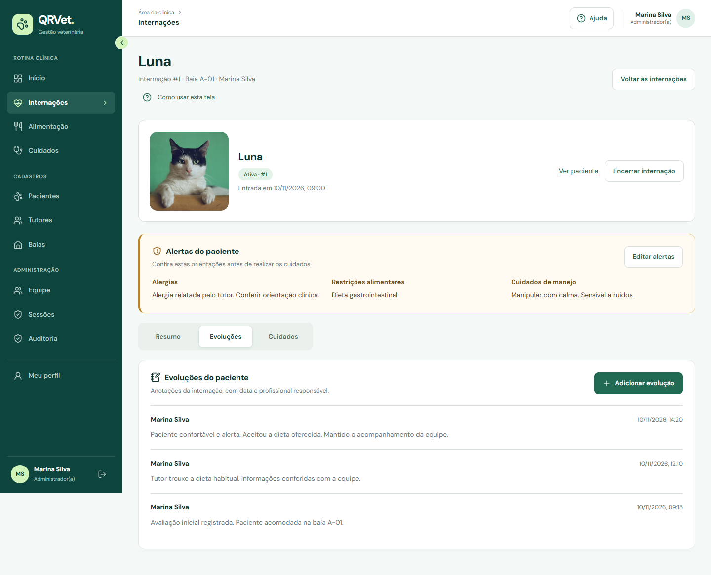
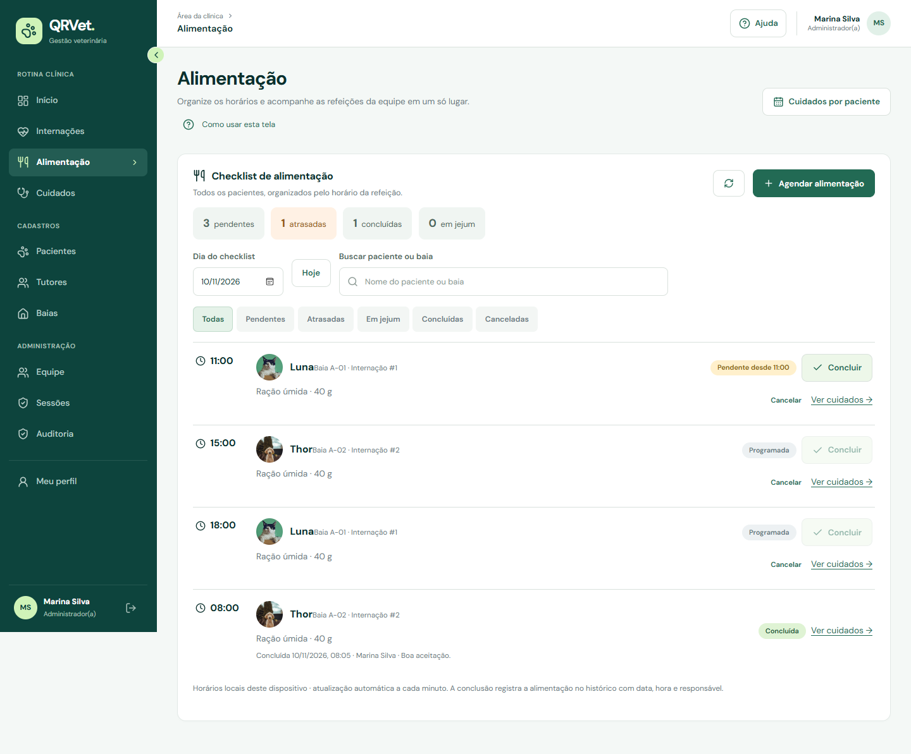
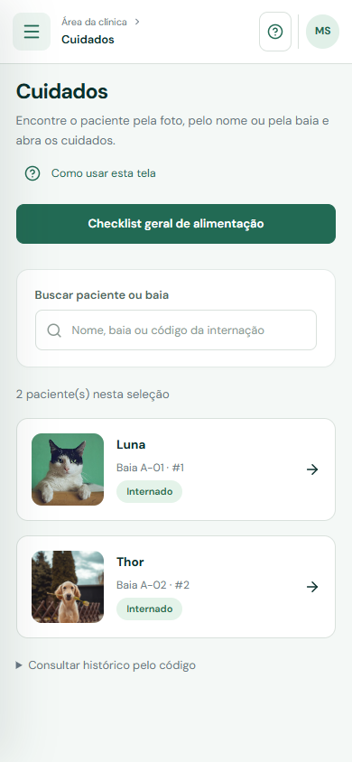
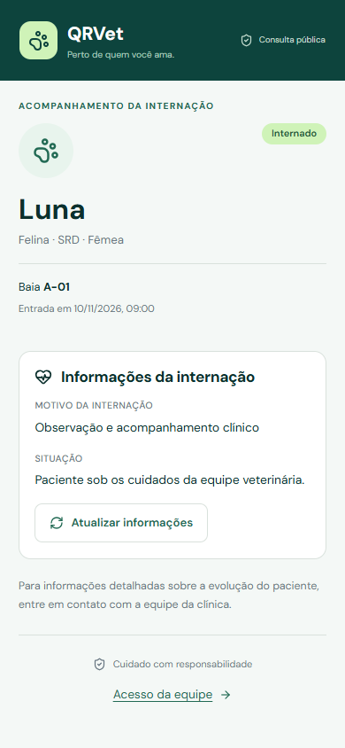

# QRVET

Sistema web para apoiar a rotina de internação veterinária, desenvolvido como Trabalho de Graduação do curso de Análise e Desenvolvimento de Sistemas da **Fatec Ipiranga**.

O QRVET reúne pacientes, tutores, baias, internações, alimentação, jejum e registros da equipe. A identificação por foto ajuda a localizar o paciente, e a etiqueta com QR Code abre sua internação no celular. O tutor recebe um link separado para acompanhar um resumo do atendimento.

[Como executar](#como-executar-com-docker) · [Primeiro acesso](#primeiro-acesso-e-preparação-da-clínica) · [Tecnologias](#tecnologias) · [Desenvolvimento](#desenvolvimento) · [Testes](#testes-e-verificações) · [Docker Hub](#publicar-e-atualizar-no-docker-hub) · [Protótipo](#protótipo-e-documentação)

## Conheça a aplicação

Capturas da aplicação React com dados fictícios e respostas da API simuladas para documentação. Os nomes, contatos e registros apresentados são demonstrativos.

### Painel da clínica

Indicadores de internações, disponibilidade das baias, refeições do dia, pacientes e acessos rápidos.



### Identificação e acompanhamento do paciente

A foto acompanha a ficha e a internação. A equipe consulta alertas de alergias, dieta e manejo e navega entre **Resumo**, **Evoluções** e **Cuidados**.



<details>
<summary>Ver pacientes, evoluções e alimentação</summary>

**Pacientes**



**Evoluções da internação**



**Checklist de alimentação**



</details>

### Uso no celular

<table>
  <tr>
    <th>Cuidados por paciente</th>
    <th>Acompanhamento do tutor</th>
  </tr>
  <tr>
    <td></td>
    <td></td>
  </tr>
</table>

## Funcionalidades

| Módulo | O que permite fazer |
| --- | --- |
| Painel inicial | Consultar internações ativas, ocupação das baias, pacientes e refeições do dia. |
| Pacientes e tutores | Cadastrar paciente com tutor existente ou novo tutor, editar dados, consultar contatos e histórico de internações. |
| Fotos | Enviar, substituir e remover a foto do paciente; identificar o animal nas listas, na internação e nos cuidados. |
| Baias | Cadastrar e editar espaços, consultar disponibilidade e sinalizar manutenção. A ocupação é atualizada pela internação. |
| Internações | Vincular paciente, baia e veterinário, acompanhar o atendimento, consultar histórico e encerrar por alta ou óbito. |
| Alertas | Registrar alergias, restrições alimentares e cuidados de manejo, com destaque nas telas autorizadas. |
| Evoluções | Adicionar anotações com data, horário e autoria. Os registros permanecem no histórico e não têm edição ou exclusão pela interface. |
| Alimentação | Agendar até oito horários por dia, repetir a programação por até 31 dias, localizar pendências e confirmar ou cancelar refeições. |
| Cuidados | Registrar alimentação e medicação e consultar o histórico por internação. |
| Jejum | Iniciar e encerrar episódios. O servidor bloqueia novos registros de alimentação enquanto houver jejum ativo. |
| QR Code | Imprimir a etiqueta da internação para acesso da equipe pela câmera do celular. |
| Acompanhamento do tutor | Enviar por e-mail um link público com informações resumidas, sem exigir login do tutor. |
| Equipe e sessões | Convidar profissionais, definir perfis e consultar ou revogar sessões, conforme as permissões. |
| Auditoria | Consultar eventos selecionados de autenticação e operações do sistema. |
| Meu perfil | Atualizar o próprio nome e alterar a senha. |
| Ajuda | Consultar orientações iniciais por perfil e dicas contextuais das telas. |

Buscas, filtros e páginas das listas ficam na URL. Ao voltar à lista, o sistema procura restaurar a posição de rolagem. As abas da internação também podem ser usadas pelo teclado.

## Perfis de acesso

A interface mostra as ferramentas do perfil, e a API aplica as regras de autorização.

| Operação | Administrador | Veterinário | Recepcionista | Auxiliar técnico |
| --- | :---: | :---: | :---: | :---: |
| Painel, pacientes, tutores e consulta de baias | Sim | Sim | Sim | — |
| Abrir e encerrar internações | Sim | Sim | Sim | — |
| Editar alertas do paciente | Sim | Sim | — | — |
| Consultar cuidados e alertas no contexto da internação | Sim | Sim | Resumo da internação | Sim |
| Alimentação, medicação e jejum | Sim | Sim | — | Sim |
| Registrar e consultar evoluções | Sim | Sim | — | Sim |
| Cadastrar e alterar baias | Sim | — | — | — |
| Gerenciar equipe, sessões e auditoria | Sim | — | — | — |
| Atualizar o próprio perfil | Sim | Sim | Sim | Sim |

O **tutor** consulta o resumo pelo link recebido por e-mail. Esse acesso não expõe as anotações internas, os alertas ou os dados privados de contato. O auxiliar pode consultar a foto pela internação sem acessar o cadastro do tutor.

## Tecnologias

As versões abaixo vêm dos manifestos e das imagens configuradas neste repositório. Para reproduzir as dependências do frontend, use o `package-lock.json` com `npm ci`.

| Camada | Tecnologias |
| --- | --- |
| Frontend | React 19.2, TypeScript 6.0, React Router 7.18 e Vite 8.2. |
| Interface | Bootstrap 5.3, Lucide React e estilos CSS próprios, com identidade visual verde e layout responsivo. |
| Backend | Java 21 e Spring Boot 4.1.1. |
| API e regras | Spring Web MVC, Bean Validation, Spring Data JPA e Hibernate. |
| Autenticação | Spring Security, JWT com HMAC-SHA256, senhas BCrypt, renovação de sessão em cookie HttpOnly e proteção CSRF. |
| Banco de dados | MySQL 8.4.11 no Compose principal; TiDB compatível com MySQL no ambiente de desenvolvimento configurado. |
| Migrações | Flyway no perfil `prod`. |
| Sessões e tokens temporários | Redis 8.2. |
| E-mail | Spring Mail e SMTP; Mailpit 1.27.4 no Compose de desenvolvimento. |
| QR Code | ZXing 3.5.3 no backend. |
| Fotos | Arquivos no disco/volume do backend e referência persistida no banco. |
| Entrega do frontend | Nginx 1.27, com proxy das chamadas para a API. |
| Testes do backend | JUnit, Spring Boot Test, H2 e Testcontainers com MySQL. |
| Qualidade do frontend | Oxlint, compilação TypeScript e testes de navegador com Playwright. |
| Execução e integração contínua | Docker, Docker Compose, Maven Wrapper, npm e GitHub Actions. |

## Estrutura do repositório

```text
qrvet/
├── backend/
│   ├── src/main/java/ipiranga/fatec/qrvet/
│   │   ├── controllers/       # Endpoints da API
│   │   ├── dtos/              # Dados de entrada e saída
│   │   ├── models/            # Entidades e enumerações
│   │   ├── repositories/      # Persistência
│   │   ├── security/          # Autenticação e autorização
│   │   └── services/          # Regras de negócio
│   ├── src/main/resources/    # Configurações e migrações Flyway
│   ├── src/test/              # Testes automatizados
│   ├── Dockerfile
│   └── pom.xml
├── frontend/
│   ├── src/                  # Páginas, componentes, autenticação e serviços
│   ├── tests/                # Roteiros Playwright
│   ├── Dockerfile
│   ├── nginx.conf
│   └── package.json
├── docs/
│   ├── images/               # Capturas usadas neste README
│   ├── scripts/              # Geração das capturas
│   └── clinical-records-api.md
├── figma-design/              # Protótipo e fontes da construção no Figma
├── .github/workflows/         # Verificações de integração contínua
├── .env.example              # Modelo do ambiente principal
├── .env.dev.example          # Modelo do ambiente TiDB de desenvolvimento
├── docker-compose.yml        # MySQL, Redis, backend e frontend
└── docker-compose.dev.yml    # TiDB externo, Redis, Mailpit e modo de desenvolvimento
```

## Requisitos

Para executar toda a aplicação em contêineres:

- Git, se for clonar o projeto.
- Docker Engine ou Docker Desktop iniciado, com suporte a contêineres Linux.
- Docker Compose v2, disponível pelo comando `docker compose`.
- Internet no primeiro build para baixar imagens e dependências.
- Portas `3000`, `8080`, `3306` e `6379` disponíveis para o Compose principal.

Para desenvolver fora dos contêineres, use também **JDK 21** e **Node.js 22 atualizado**, com npm. O Maven é fornecido pelo Wrapper do projeto; não é necessário instalá-lo separadamente.

Os comandos abaixo usam PowerShell no Windows. Em Linux/macOS, use `cp` no lugar de `Copy-Item` e `./mvnw` no lugar de `.\mvnw.cmd`.

## Como executar com Docker

Este é o caminho recomendado para executar frontend, backend, MySQL e Redis juntos.

### 1. Obter o código

```powershell
git clone https://github.com/mateusbaldu/qrvet.git
cd qrvet
```

Se o projeto já estiver no computador, abra o terminal na pasta que contém `docker-compose.yml`.

### 2. Conferir o Docker

```powershell
docker --version
docker compose version
docker info
```

O último comando precisa conseguir se comunicar com o Docker Engine. No Windows, aguarde o Docker Desktop terminar de iniciar.

### 3. Preparar as configurações

Crie o arquivo local somente se ainda não existir:

```powershell
Copy-Item .env.example .env
```

Edite o `.env` antes da primeira inicialização:

1. Mantenha `SPRING_PROFILE=prod` para o MySQL local deste Compose. Nesse perfil, o Flyway aplica as migrações e o Hibernate valida o esquema.
2. Defina `DB_PASSWORD` e `DB_ROOT_PASSWORD`.
3. Preencha `JWT_SECRET` com uma chave Base64 que represente pelo menos 32 bytes.
4. Defina `BOOTSTRAP_SECRET` e os dados `BOOTSTRAP_ADMIN_NAME`, `BOOTSTRAP_ADMIN_EMAIL` e `BOOTSTRAP_ADMIN_PASSWORD`. Mantenha `BOOTSTRAP_ADMIN_ENABLED=true` para criar o primeiro administrador automaticamente.
5. Use `FRONTEND_URL=http://localhost:3000` para acessar somente neste computador e `COOKIE_SECURE=false` no ambiente HTTP local.
6. Configure o SMTP se for testar convites, recuperação de senha e envio de acompanhamento ao tutor.

Para gerar uma chave de 32 bytes em Base64 pelo PowerShell:

```powershell
$jwtBytes = New-Object byte[] 32
[System.Security.Cryptography.RandomNumberGenerator]::Create().GetBytes($jwtBytes)
[Convert]::ToBase64String($jwtBytes)
```

Copie o resultado para `JWT_SECRET`. Não compartilhe o arquivo `.env`; ele já é ignorado pelo Git.

**E-mail no ambiente principal:** o `.env.example` contém `MAIL_HOST=mailpit` como exemplo. O `docker-compose.yml` principal **não inclui um serviço Mailpit**. Configure um servidor SMTP alcançável ou use o ambiente de desenvolvimento descrito adiante. Uma configuração de e-mail incorreta impede o envio das mensagens, embora as demais telas possam iniciar.

O Compose tem valores padrão para demonstração e pode iniciar sem `.env`. Este passo a passo usa o arquivo local para deixar explícitas as configurações e as credenciais escolhidas. Não reutilize os valores de demonstração em uma publicação externa.

### 4. Construir e iniciar os serviços

```powershell
docker compose up -d --build
```

Na primeira execução, o build pode levar alguns minutos. O backend aguarda MySQL e Redis ficarem disponíveis. As migrações são aplicadas na inicialização da API.

Confira o estado e os logs:

```powershell
docker compose ps
docker compose logs -f backend
```

Use `Ctrl+C` para sair do acompanhamento dos logs; isso não encerra os contêineres.

### 5. Abrir a aplicação

| Serviço | Endereço ou porta no computador |
| --- | --- |
| Aplicação web | [http://localhost:3000](http://localhost:3000) |
| Login | [http://localhost:3000/login](http://localhost:3000/login) |
| API | `http://localhost:8080/qrvet/api/v1` |
| MySQL | `localhost:3306` |
| Redis | `localhost:6379` |

A raiz da API não é uma página inicial. O uso normal ocorre pela aplicação na porta `3000`; o Nginx encaminha as chamadas HTTP para o backend.

### 6. Parar e iniciar novamente

```powershell
# Parar os serviços, preservando os volumes.
docker compose down

# Iniciar novamente as imagens já construídas.
docker compose up -d
```

`docker compose down -v` remove os volumes, incluindo banco e fotos. Use essa opção somente quando a intenção for apagar os dados do ambiente.

## Primeiro acesso e preparação da clínica

1. Entre em `/login` com o e-mail e a senha definidos em `BOOTSTRAP_ADMIN_EMAIL` e `BOOTSTRAP_ADMIN_PASSWORD` no `.env`.
2. Em **Equipe**, convide os profissionais e escolha os perfis. O veterinário precisa aceitar o convite para estar disponível na abertura de internação.
3. Em **Baias**, cadastre os espaços disponíveis.
4. Em **Pacientes**, cadastre um paciente, vincule um tutor e adicione a foto. É possível criar o tutor na mesma tela.
5. Abra a internação e selecione o paciente, uma baia disponível e o veterinário responsável.
6. Registre os alertas e a primeira evolução; programe a alimentação conforme a orientação da equipe.
7. Consulte o QR Code para imprimir a etiqueta e, se desejar, envie o link de acompanhamento ao tutor.

A criação automática do administrador só ocorre se ainda não houver um administrador no banco. Alterar essas variáveis depois não modifica a senha de uma conta existente.

Se a criação automática estiver desativada e o banco ainda não tiver administrador, use `/configuracao-inicial` e informe a chave configurada em `BOOTSTRAP_SECRET`. Após a criação, use o login normal. O endpoint recusa criar outro administrador por esse fluxo quando já existe um.

## Usar o QR Code em outro dispositivo

O celular precisa alcançar o computador ou servidor que executa o QRVET.

1. Conecte os dispositivos à mesma rede, ou disponibilize o sistema em um domínio acessível.
2. Configure `QRVET_FRONTEND_URL` no `.env` com o IP/domínio e a porta do frontend, por exemplo `http://192.168.1.50:3000`.
3. Se `QRVET_PUBLIC_URL` estiver definido, confira se também aponta para o endereço desejado.
4. Recrie o backend para aplicar as variáveis:

```powershell
docker compose up -d backend
```

5. Abra a internação e gere/visualize novamente a etiqueta.

No celular, `localhost` aponta para o próprio celular. Por isso, os links precisam usar o IP ou domínio do servidor. Confira também a liberação da porta pelo firewall e pela rede.

A etiqueta abre `/internacoes/:id` e exige a sessão da equipe. O auxiliar técnico é direcionado a `/cuidados?internacao=:id`. O acompanhamento do tutor usa `/public/internacoes/qr/:token`, enviado por e-mail, sem exigir login. A consulta manual em `/consultar-qr` continua disponível como apoio, sem item no menu lateral ou no cabeçalho.

## Configurações do ambiente

### Compose principal

Estas variáveis são lidas do `.env` pelo `docker-compose.yml`:

| Variável | Finalidade |
| --- | --- |
| `SPRING_PROFILE` | Perfil Spring. Use `prod` com o banco MySQL do Compose principal. |
| `TZ` | Fuso do contêiner; padrão `America/Sao_Paulo`. |
| `DB_NAME`, `DB_USER` | Banco e usuário da aplicação. |
| `DB_PASSWORD`, `DB_ROOT_PASSWORD` | Senhas do usuário da aplicação e do administrador do MySQL. |
| `JWT_SECRET` | Chave de assinatura JWT, em Base64 com pelo menos 32 bytes. `QRVET_JWT_SECRET` tem prioridade. |
| `FRONTEND_URL` | Origem do frontend, por exemplo `http://localhost:3000`. |
| `QRVET_FRONTEND_URL` | Sobrescreve `FRONTEND_URL` e é usada para formar os links do frontend. |
| `QRVET_PUBLIC_URL` | Sobrescreve a origem usada pelos links de internação/acompanhamento. |
| `COOKIE_SECURE` | `false` para HTTP local; `true` quando o ambiente atende por HTTPS. `QRVET_COOKIE_SECURE` tem prioridade. |
| `BOOTSTRAP_SECRET` | Chave do fluxo manual de configuração inicial. |
| `BOOTSTRAP_ADMIN_ENABLED` | Ativa a criação automática do primeiro administrador. |
| `BOOTSTRAP_ADMIN_NAME`, `BOOTSTRAP_ADMIN_EMAIL`, `BOOTSTRAP_ADMIN_PASSWORD` | Dados do primeiro administrador. As variantes com prefixo `QRVET_` têm prioridade. |
| `REDIS_HOST`, `REDIS_PORT` | Endereço do Redis visto pelo backend; padrão `redis:6379` na rede Docker. |
| `MAIL_HOST`, `MAIL_PORT` | Servidor e porta SMTP alcançáveis pelo backend. |
| `MAIL_USERNAME`, `MAIL_PASSWORD` | Credenciais SMTP, quando o provedor exigir autenticação. |
| `MAIL_AUTH`, `MAIL_STARTTLS`, `MAIL_SSL` | Opções do provedor SMTP. |
| `MAIL_FROM` | Remetente dos e-mails. `QRVET_MAIL_FROM` tem prioridade. |

Os endereços de banco e Redis dentro da rede Docker usam os nomes dos serviços (`database` e `redis`), e não `localhost`.

### Arquivos de configuração

| Arquivo | Uso |
| --- | --- |
| `.env` | Variáveis do Compose principal; não é carregado automaticamente pelo Java executado diretamente. |
| `.env.dev` | Variáveis do Compose de desenvolvimento, selecionadas por `--env-file`. |
| `backend/src/main/resources/application.properties` | Configuração comum da API. |
| `application-prod.properties` | Flyway habilitado e esquema validado para o banco configurado. |
| `application-dev.properties` | Conexão TiDB com TLS, Flyway desabilitado e `ddl-auto=update`. |
| `secrets.properties` | Arquivo local opcional carregado pelo backend; há um modelo `secrets.properties.example`. |
| `frontend/.env.local` | Variáveis de desenvolvimento do Vite, quando necessárias. |

Em `secrets.properties`, use sintaxe de propriedades, como `qrvet.jwt-secret=...` ou `spring.datasource.username=...`, ou forneça os nomes de ambiente equivalentes ao processo Java. Não versione configurações locais com credenciais.

## Desenvolvimento

### Frontend local com backend no Docker

Com o backend e suas dependências já configurados:

```powershell
# Na raiz.
docker compose up -d --build backend

# Em outro terminal.
cd frontend
npm ci
npm run dev
```

O frontend abre em `http://localhost:5173`. O Vite encaminha `/qrvet/api` para `http://localhost:8080`.

Para testar convites e QR Codes nessa configuração, ajuste `QRVET_FRONTEND_URL=http://localhost:5173` no `.env` e recrie o backend. Volte para `http://localhost:3000` quando voltar a usar o frontend do Compose.

Para outra API de desenvolvimento, o proxy aceita `API_PROXY_TARGET`:

```powershell
$env:API_PROXY_TARGET = 'http://localhost:8080'
npm run dev
```

`VITE_API_URL` altera a URL consumida pelo frontend e deve incluir o prefixo, por exemplo `http://localhost:8080/qrvet/api/v1`. É uma configuração de **compilação**: alterá-la exige reiniciar o Vite ou reconstruir a imagem. O proxy com chamadas relativas evita configuração adicional de origem no fluxo local padrão.

### Backend local com JDK 21

Inicie MySQL e Redis com o Compose:

```powershell
# Na raiz.
docker compose up -d database redis
```

Em outro terminal, configure o processo Java com os mesmos dados definidos para o banco no `.env`:

```powershell
cd backend

$env:SPRING_PROFILES_ACTIVE = 'prod'
$env:SPRING_DATASOURCE_URL = 'jdbc:mysql://localhost:3306/qrvet'
$env:SPRING_DATASOURCE_USERNAME = 'qrvet'
$env:SPRING_DATASOURCE_PASSWORD = 'SUA_SENHA_DO_BANCO'
$env:SPRING_DATA_REDIS_HOST = 'localhost'
$env:SPRING_DATA_REDIS_PORT = '6379'
$env:QRVET_JWT_SECRET = 'SUA_CHAVE_BASE64'
$env:QRVET_BOOTSTRAP_SECRET = 'SUA_CHAVE_DE_CONFIGURACAO'
$env:QRVET_FRONTEND_URL = 'http://localhost:5173'
$env:QRVET_COOKIE_SECURE = 'false'

.\mvnw.cmd spring-boot:run
```

Se o banco ainda não tiver administrador, use a configuração inicial. Para e-mails no processo local, forneça também `SPRING_MAIL_HOST`, `SPRING_MAIL_PORT` e as demais opções `SPRING_MAIL_*` do seu SMTP. No Linux/macOS, exporte as variáveis e execute `./mvnw spring-boot:run`.

Evite iniciar o backend local e o backend Docker na mesma porta `8080`.

### Compose de desenvolvimento com TiDB e Mailpit

O `docker-compose.dev.yml` é um ambiente separado: usa **TiDB externo**, Redis, Mailpit e aplicações em modo de desenvolvimento. Ele não cria um MySQL local.

1. Crie `.env.dev` se ainda não existir:

```powershell
Copy-Item .env.dev.example .env.dev
```

2. Preencha `TIDB_HOST`, `TIDB_PORT`, `TIDB_DATABASE`, `TIDB_USERNAME` e `TIDB_PASSWORD` com os dados de uma instância TiDB acessível. Defina também `QRVET_JWT_SECRET` em Base64 e `QRVET_BOOTSTRAP_SECRET`.
3. Inicie com sincronização do código:

```powershell
docker compose --env-file .env.dev -f docker-compose.dev.yml up --build --watch
```

| Serviço | Endereço |
| --- | --- |
| Frontend Vite | `http://localhost:5173` |
| API | `http://localhost:8080/qrvet/api/v1` |
| Caixa de e-mails Mailpit | `http://localhost:8025` |
| TiDB | Endereço externo definido em `.env.dev` |

O Mailpit recebe as mensagens de teste e permite abrir os links de convite e recuperação sem enviá-los a uma caixa real. O backend usa a porta SMTP `1025` dentro da rede Docker.

Esse Compose desativa a criação automática do administrador. Em um banco novo, acesse `http://localhost:5173/configuracao-inicial`. O perfil `dev` desativa o Flyway e usa atualização do esquema pelo Hibernate; ele não substitui a validação das migrações do perfil `prod`.

Para parar:

```powershell
docker compose --env-file .env.dev -f docker-compose.dev.yml down
```

Não execute os dois backends simultaneamente na porta `8080`. As portas deste Compose estão vinculadas a `127.0.0.1`; o acesso por outro dispositivo exige adaptar a publicação das portas e os endereços.

## Testes e verificações

### Backend

```powershell
cd backend
.\mvnw.cmd test
```

Em Linux/macOS:

```bash
cd backend
./mvnw test
```

Os testes cobrem regras de negócio, autenticação, permissões, cadastro, alimentação, jejum, evoluções, alertas, fotos e encerramento. Testes de integração usam H2; a verificação específica de migração MySQL usa Testcontainers e precisa de Docker disponível. Os relatórios ficam em `backend/target/surefire-reports/`. Consulte falhas e testes ignorados antes de considerar a execução validada.

### Frontend

```powershell
cd frontend
npm ci
npm run lint
npm run build
```

O build gera `frontend/dist/`. Para inspecioná-lo localmente, `npm run preview` serve a compilação; essa prévia não fornece o backend nem o proxy do servidor de desenvolvimento.

### Navegador

Mantenha o Vite em execução em um terminal:

```powershell
cd frontend
npm run dev
```

Em outro terminal:

```powershell
cd frontend
npx playwright install chromium
npm run test:e2e
```

Para usar o Microsoft Edge já instalado no Windows:

```powershell
$env:PLAYWRIGHT_CHANNEL = 'msedge'
npm run test:e2e
```

| Comando | Escopo |
| --- | --- |
| `npm run test:e2e` | Todos os roteiros de interface configurados no projeto. |
| `npm run test:dashboard` | Indicadores, busca, permissões e responsividade do painel. |
| `npm run test:onboarding` | Ajuda inicial, retomada, teclado e perfis. |
| `npm run test:clinical-records` | Perfil editável, alertas, evoluções, fotos e celular. |
| `npm run test:ux` | Abas, fotos nas refeições, busca, filtros, retorno e rolagem. |

Para testar outro endereço, defina `TEST_BASE_URL`. Os roteiros usam **respostas HTTP simuladas** para verificar a interface; não comprovam entrega de e-mail, persistência em MySQL ou uso clínico real. As verificações Java e os testes no ambiente de execução complementam esse escopo.

### Regenerar os prints deste README

Com o Vite iniciado e o Playwright instalado:

```powershell
# Na raiz; omita PLAYWRIGHT_CHANNEL se for usar Chromium instalado pelo Playwright.
$env:PLAYWRIGHT_CHANNEL = 'msedge'
node docs/scripts/capture-screenshots.mjs
```

As imagens são salvas em `docs/images/`. O roteiro usa dados fictícios, intercepta as chamadas HTTP e não grava informações no backend. As fotos demonstrativas estão em `figma-design/assets/`, com os créditos no [README do protótipo](figma-design/README.md).

## Publicar e atualizar no Docker Hub

As imagens configuradas são:

- `kazicas/qrvet-backend:latest`
- `kazicas/qrvet-frontend:latest`

Para publicar as alterações locais, entre com uma conta autorizada e execute na raiz:

```powershell
docker login -u kazicas
docker compose build backend frontend
docker compose push backend frontend
```

Somente o frontend:

```powershell
docker compose build frontend
docker compose push frontend
```

Para usar outro namespace, altere os campos `image:` do Compose antes de publicar.

### Atualizar a máquina que executa o sistema

```powershell
docker compose pull backend frontend
docker compose up -d --no-build backend frontend
docker compose ps
```

O `pull` baixa as novas imagens, e o `up` recria os serviços necessários. Os volumes do banco e das fotos permanecem. No backend, as migrações pendentes são executadas ao iniciar no perfil `prod`.

Para usar imagens publicadas em outra máquina, leve o `docker-compose.yml` e prepare ali um `.env` com as configurações necessárias. Depois:

```powershell
docker compose pull
docker compose up -d --no-build
```

Esse fluxo não precisa de Node, Java ou do código-fonte na máquina de execução. Os dados existentes não são transferidos pelas imagens: migração de ambiente exige backup e restauração separados.

Ao publicar uma versão que precise ser reproduzida depois, use também uma tag identificável, como `v1.0.0` ou o commit, e atualize o Compose de destino. A tag `latest` passa a apontar para a última imagem enviada com esse nome.

## Persistência e fotos

O Compose principal usa:

| Volume | Conteúdo |
| --- | --- |
| `database_data` | Dados do MySQL, incluindo pacientes, tutores, internações e históricos. |
| `patient_photos` | Fotos dos pacientes em `/opt/app/uploads`. |

O Docker acrescenta o nome do projeto aos volumes. Consulte `docker volume ls` para encontrar os nomes efetivos.

No backend executado diretamente, as fotos ficam em `./uploads`, relativo à pasta de execução. `QRVET_UPLOAD_DIR` pode alterar esse diretório. Para alterar o diretório no Docker, ajuste também o mapeamento do volume; somente criar a variável no `.env` não a encaminha automaticamente ao serviço.

São aceitos JPG/PNG de até **5 MB** e **16 megapixels**. O servidor valida o conteúdo e salva JPEG com até **1.280 px** no maior lado. O upload é independente do cadastro: se falhar, o paciente salvo permanece e a ficha permite tentar novamente.

Faça backup consistente do **banco e das fotos**. Recriar imagens não substitui backup. Alterar `DB_PASSWORD` no `.env` também não troca automaticamente a senha de um usuário já criado no volume MySQL; a mudança precisa ser aplicada no banco.

## Problemas comuns

| Sintoma | O que conferir |
| --- | --- |
| `docker info` não conecta | Docker Desktop/Engine iniciado e contêineres Linux habilitados. |
| Porta ocupada | Outro processo ou outro Compose usando `3000`, `5173`, `8080`, `3306` ou `6379`. |
| Frontend abre, mas mostra erro de conexão | `docker compose ps` e `docker compose logs backend`; aguarde banco e migrações. |
| Backend falha na chave JWT | Valor Base64 válido, representando pelo menos 32 bytes. |
| Login inicial não funciona | Dados do bootstrap, existência de administrador anterior e logs de inicialização. Alterar o `.env` não redefine contas existentes. |
| Veterinário não aparece na internação | Profissional com perfil correto, ativo e com convite aceito. |
| Convite, recuperação ou link do tutor não chega | SMTP, autenticação, TLS e remetente. No ambiente dev, abra o Mailpit; no principal, `mailpit` não existe por padrão. |
| QR Code abre endereço inacessível no celular | IP/domínio do servidor, `QRVET_FRONTEND_URL`, `QRVET_PUBLIC_URL`, porta e firewall. |
| Refeição não pode ser concluída | Horário já alcançado, internação ativa, item pendente e ausência de jejum. |
| Foto não aparece | Formato/tamanho aceitos, upload concluído, autorização e volume/diretório de arquivos. |
| MySQL recusa a senha depois de editar o `.env` | O volume já foi inicializado com outra senha. Ajuste a credencial no banco; não apague o volume para corrigir login. |
| Build não encontra dependências | Internet/registro de pacotes acessível. Use `npm ci` e o Maven Wrapper, preservando os arquivos de lock. |
| Playwright não encontra navegador | `npx playwright install chromium` ou `PLAYWRIGHT_CHANNEL=msedge` com Edge instalado. |
| Cookie não é enviado em HTTP local | `COOKIE_SECURE=false` e origem do frontend corretamente configurada. |

Para acompanhar a execução:

```powershell
docker compose logs -f backend frontend
```

## Protótipo e documentação

- [Protótipo navegável no Figma](https://www.figma.com/proto/OD9iJUZvOZx1GhdthN0REM?node-id=9-335&starting-point-node-id=9%3A335).
- [Arquivo editável no Figma](https://www.figma.com/design/OD9iJUZvOZx1GhdthN0REM).
- [Escopo, fontes e validação do protótipo](figma-design/README.md).
- [Contrato de evoluções, alertas e perfil](docs/clinical-records-api.md).
- [Detalhes do frontend e da navegação](frontend/README.md).

O protótipo demonstra jornadas com dados fictícios. A aplicação implementada é a referência para o comportamento real e para as permissões da API.

## Integração contínua

- `.github/workflows/homolog.yaml`: testes do backend com Java 21 e lint/build do frontend com Node 22 em pushes e pull requests para `homologacao`.
- `.github/workflows/prod.yaml`: construção da imagem Docker do backend em pushes e pull requests para `main`.

O workflow de produção atual constrói a imagem; ele não executa publicação no Docker Hub nem implantação automática. A suíte Playwright é executada separadamente pelos comandos documentados acima.

## Roteiro de demonstração

1. Cadastre tutor e paciente, com foto, e abra a internação.
2. Mostre a identificação, os alertas e as abas da internação.
3. Registre uma evolução e confira profissional, data e horário.
4. Agende refeições e localize as pendências no checklist.
5. Inicie jejum e demonstre o bloqueio de alimentação.
6. Encerre o jejum e confirme uma refeição cujo horário já chegou.
7. Abra o acesso da equipe pela etiqueta e o resumo público pelo link do tutor.
8. Encerre a internação e confira a liberação da baia e a preservação do histórico.

A agenda é consultada na aplicação e atualizada periodicamente; ela não envia notificações automáticas de horário. O envio de e-mails ocorre nas ações específicas da equipe.

## Equipe

- Mateus Balduino da Silva
- Anthony Akio Neves
- Vitor Vieira da Hora
- Kauan Torres
- Washington Luis

Projeto acadêmico da Fatec Ipiranga.
